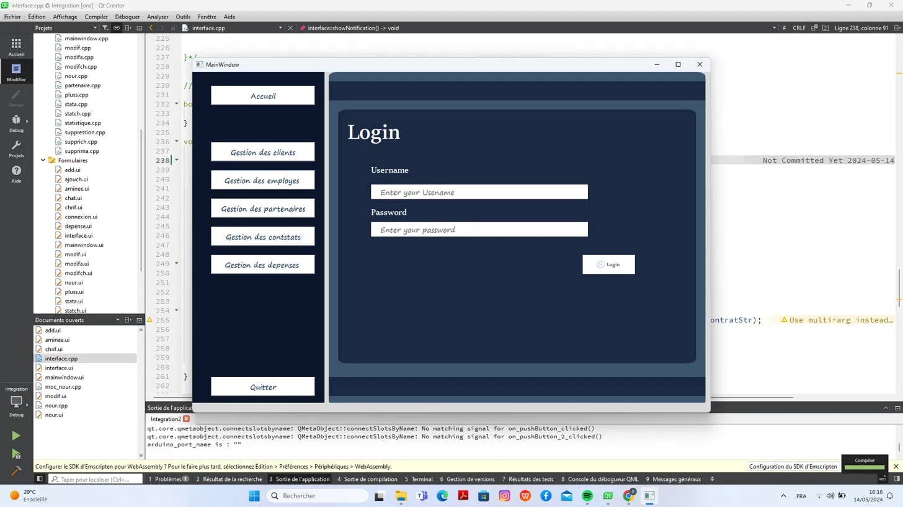
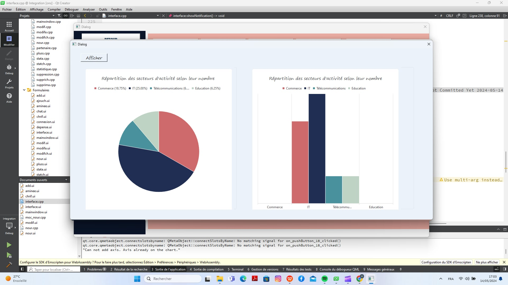

# 🛡️ Gcorp – Application de gestion d'assurance

> Application de bureau développée en **C++ / Qt** pour centraliser et simplifier la gestion d'une compagnie d'assurance.
> Projet réalisé par l'équipe **NexApp** (*Nexus Approach Team*) – Esprit , 2ème année, 2023/2024.


---

## 📌 Contexte et problématique

Les compagnies d'assurance doivent faire face à de nombreux défis :

- **Efficacité opérationnelle** : processus manuels et systèmes hérités qui ralentissent la réactivité.
- **Gestion des risques** : manque d'intégration et de contrôles, avec des risques sur la sécurité des données et les erreurs de traitement.
- **Expérience client** : un service insatisfaisant réduit la fidélité et la confiance.

**Gcorp** (*Gestion Corporation*) répond à ces enjeux avec une solution **centralisée, intuitive et connectée**.

---

## ✨ Modules

| Module | Description |
|---|---|
| 👤 **Gestion des utilisateurs** | Authentification, gestion des comptes et des employés |
| 🧑‍💼 **Gestion des clients** | Fiches clients (CIN, coordonnées, type de client, date d'arrivée) |
| 📄 **Gestion des constats** | Suivi et traitement des constats / sinistres |
| 💰 **Gestion du budget** | Suivi des dépenses et du budget |
| 🤝 **Gestion du sponsoring** | Gestion des partenaires et des contrats de sponsoring |

## 🚀 Fonctionnalités

- ✅ **CRUD complet** pour chaque module (ajouter, modifier, supprimer, consulter)
- 🔍 **Recherche avancée** et **tri**
- 📊 **Statistiques** par module (graphiques en secteurs et en barres via Qt Charts)
- 📑 **Export PDF**
- 📧 **Envoi d'e-mails**
- 🕘 **Historique des modifications**
- 🔔 **Notification de fin de contrat**
- 🤖 **Chatbot IA intégré** (*Nexapp AI Chat*)

### 🔌 Fonctionnalités IoT (Arduino)

- **Système de pointage** des employés (enregistrement des heures de travail)
- **Gestion de l'accès aux services client** : orientation des clients vers leurs guichets

---

## 🖼️ Aperçu

| Connexion | Gestion des clients |
|:---:|:---:|
|  |  |

| Statistiques | Chatbot IA |
|:---:|:---:|
|   |  |

---

## 🛠️ Stack technique

- **Langage** : C++
- **Interface** : Qt Widgets, Qt Designer (fichiers `.ui`), Qt Charts
- **Base de données** : MySQL (via le module Qt SQL)
- **IoT** : Arduino (communication série)
- **IDE** : Qt Creator
- **Versionnement** : Git / GitHub

---

## ⚙️ Installation

### Prérequis

- Qt 5.15+ ou Qt 6 (modules : `widgets`, `sql`, `charts`, `serialport`, `network`, `printsupport`)
- Qt Creator
- MySQL Server + pilote ODBC / MySQL pour Qt
- (Optionnel) Carte Arduino pour les fonctionnalités IoT

### Étapes

```bash
# 1. Cloner le dépôt
git clone https://github.com/Projet-CPP-2A6/NexApp.git
cd NexApp

# 2. Créer la base de données
mysql -u root -p -e "CREATE DATABASE gcorp;"
mysql -u root -p gcorp < database/gcorp.sql   # [à adapter selon votre script]
```

3. Ouvrir le fichier `.pro` dans **Qt Creator**.
4. Configurer la connexion à la base dans le fichier de connexion (`connection.cpp`) : nom de la base, utilisateur, mot de passe.
5. Compiler et lancer (`Ctrl + R`).

---

## 📁 Structure du projet

```
NexApp/
├── Sources/        # Fichiers .cpp (logique métier, interfaces)
├── Headers/        # Fichiers .h
├── Formulaires/    # Interfaces Qt Designer (.ui)
├── Ressources/     # Images, icônes, styles
├── Arduino/        # Codes Arduino (pointage, gestion des guichets)
└── docs/           # Captures d'écran, présentation
``

---

## 🔭 Perspectives

- Intégration de la tarification dynamique basée sur les données IoT
- Version web / mobile
- Renforcement de la sécurité (chiffrement des mots de passe, gestion des rôles)
- Tableaux de bord analytiques avancés

---

## 📄 Licence

Projet académique – Esprit. Tous droits réservés à l'équipe NexApp.
